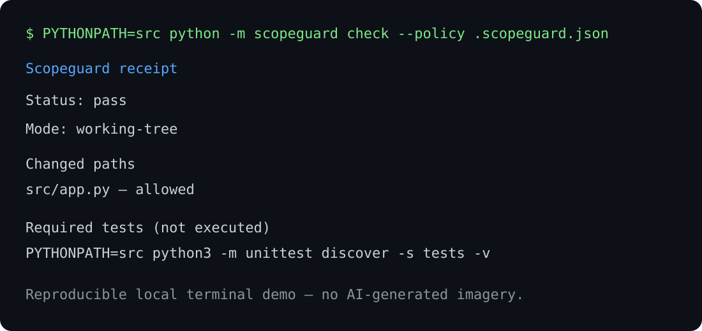

# Scopeguard

Scopeguard creates a local, deterministic receipt showing whether changed Git paths comply with an explicit JSON policy. It is designed for reviewing AI-agent patches without cloud services, API keys, telemetry, or execution of policy-provided commands.

## Quick start

```sh
PYTHONPATH=src python -m scopeguard check --policy .scopeguard.json --output-dir evidence
```

It writes stable Markdown and JSON receipts. `required_tests` are evidence labels only and are **never executed**.

## Demo



The demo is a reproducible visual rendering of the checked receipt in [`reports/qa-smoke/scopeguard-receipt.md`](reports/qa-smoke/scopeguard-receipt.md); it is not AI-generated imagery.

## Test

```sh
PYTHONPATH=src python3 -m unittest discover -s tests -v
```

## Limits

Scopeguard checks declared file-path policy only. A pass is not a correctness, security, or compliance verdict.
